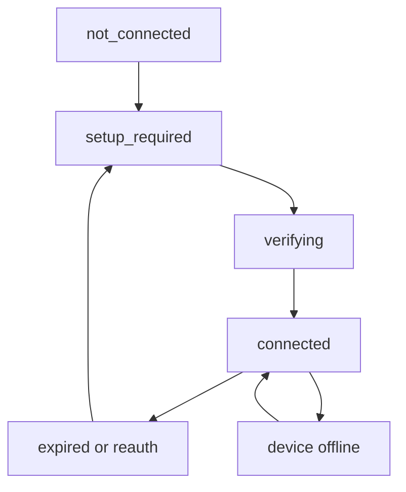

# Collection Execution and Packaging

**Status:** proposal, awaiting owner acceptance. Written 2026-11-19.

This document settles one question that [COLLECTION-AND-TEAM-PLAN.md](COLLECTION-AND-TEAM-PLAN.md) left open: where a source-site browser session actually runs, and what ships to a teammate's machine. It does not change the ownership model, the private/shared workspace split, or the rule that the application stores no session cookies.

## The problem

The current plan runs every collector inside a TinyFish Browser Context Profile, which is a browser in TinyFish's cloud. The plan assumes a teammate signs into LinkedIn, X, Luma, or Gmail once inside that cloud browser and the session keeps working.

In practice it has not kept working. The profile issued for this project, `prof_69098d3aaeb042ea`, reports no signed-in sites, and the CLI-generated setup URL returned a dashboard 404. Those two facts are recorded in `HANDOFF.md` and in the collection plan. No collector has ever completed a run against a saved session.

The likely cause is not a configuration mistake. LinkedIn and Google challenge datacenter IP addresses aggressively: forced re-authentication, two-factor prompts, and "unusual activity" interstitials. A cloud browser always presents a datacenter address. A teammate's own laptop presents the address and browser fingerprint that the source site already associates with that person. Session lifetime is the thing at risk, not storage security.

## Options

| Option | Session lifetime | Ongoing cost | Credential surface |
|---|---|---|---|
| Keep cloud-only TinyFish profiles | Weak against residential-IP challenges | Lowest | None in app |
| Electron desktop app | Good | Code signing, notarization, auto-update, two UI stacks | Tempts OS keychain token storage |
| Local collector daemon, wrapped later in Tauri | Good | One small service, then a thin shell | Unchanged |

## Decision

Run collection in a **local collector daemon**: a small service a teammate starts on their own machine, driving a persistent browser profile with Playwright. It holds that teammate's cookies on their own disk and exposes a narrow localhost contract to the existing web application.

Package it as a **Tauri** application later, once the collector is known to work. Tauri does not host browser automation, because its system webview cannot be driven by Playwright. It spawns the daemon as a sidecar and provides the tray icon, install, and connection status a non-technical teammate needs.

Build the daemon first. Building the desktop shell first would pay for packaging before discovering whether a persistent profile holds a LinkedIn session.

### Why not Electron

Electron would work, but the benefit here comes from running a browser locally, not from having a desktop UI. Electron buys that only incidentally and charges for it permanently: notarization on macOS, code signing on Windows, auto-update infrastructure, per-OS CI, and a second UI stack beside the existing React application.

It also invites a regression. Application sign-in is a sealed HttpOnly cookie from the Google-through-Octo flow, verified against `/api/me`. A desktop shell makes OS keychain token storage feel natural, which adds a new secret surface with its own rotation story. Tauri has the same temptation, so this document states the rule explicitly: **the daemon stores source-site browser state in a dedicated profile directory, and the application continues to store no cookies.**

## What changes

### `source_connection` gains device identity

A session now lives on a teammate's machine rather than in a vendor profile, so the record needs to say which machine it belongs to and when that machine last checked in.

| Field | Purpose |
|---|---|
| `device_id` | Stable identifier for one teammate's collector installation |
| `device_label` | Human name shown on the connections screen, such as a laptop name |
| `pairing_status` | Whether this device is currently paired to the principal |
| `last_seen_at` | Last successful daemon check-in, used to mark a session stale |

Everything else in the record keeps its meaning. `profile_id` and provider references stay; raw cookies and browser state still never reach the database.

### Session states gain an agent-presence dimension

The existing states describe the source site. They now also depend on whether the daemon is running, so each state carries a reason.

Read as a list: `not_connected` becomes `setup_required` when a teammate picks a source; `verifying` checks that the expected device and the requested site are both signed in; `connected` means a run may start; `expired` returns to setup; and `device offline` is a distinct condition that pauses runs without discarding the session.

The distinction matters for support. "Your LinkedIn session expired" and "your laptop is asleep" look identical to a user unless the record separates them.

### Slices

| Order | Slice | Contents |
|---|---|---|
| 1 | Daemon proof | Persistent Playwright profile, manual sign-in, one read-only LinkedIn profile fetch, restart and confirm the session survived |
| 2 | Pairing and contract | Localhost API, device pairing to a principal, `source_connection` device fields, status reporting |
| 3 | Collector integration | Plan tasks executed by the daemon, raw evidence to Octo Files, checkpoints and resume |
| 4 | Tauri shell | Tray, install, status, spawn and supervise the daemon as a sidecar |

Slice 1 is the cheap experiment. If a persistent profile cannot hold a LinkedIn session across a restart on a real machine, the rest of this plan is wrong and should be revisited before slices 2 through 4 are built.

## What stays unchanged

Octo remains canonical for entities, claims, evidence, source files, RAG, and graph projection. Each teammate still owns their own source sessions and no session is shared or inherited. Private observations still stay in per-person workspaces until explicitly published. The application still never stores cookies, passwords, one-time codes, or raw browser state. Collection still requires human approval before anything becomes a canonical fact.

## Open question: does TinyFish stay

Going local replaces TinyFish's cloud browser with Playwright on the teammate's machine. That removes a vendor and a credential store, and it gives up the proxy management and anti-detection work TinyFish provides.

This document does not settle it, because the answer depends on whether the collector can reach LinkedIn reliably from a home connection without that help. Slice 1 answers it. Two outcomes are acceptable:

- If a plain persistent profile works, drop TinyFish and keep the daemon.
- If challenges block collection, keep TinyFish as a *transport* behind the same daemon contract, and the device fields still apply because the daemon still owns pairing and scheduling.

The daemon contract is deliberately written so this choice stays reversible.

## Counter-signal

The local daemon moves an operational burden onto teammates. A daemon that is not running is a collector that is not collecting, and every teammate now has something to install and keep current. If the team turns out to be small and tolerant of a terminal command, the Tauri shell in slice 4 is optional work that can wait indefinitely.

There is also no evidence yet that a local session survives longer than a cloud one for these particular sites. That is an assumption with a plausible mechanism behind it, not a measured result. Slice 1 exists to test it.
