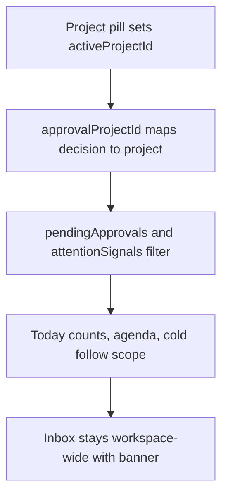

### Summary
The Today dashboard renders the same decisions and moves under every project scope: the project pill filters only mission lists, while the headline decision count, the Glance agenda ("Your 3 moves today"), Needs attention, My approvals, and Going cold all read the whole workspace. Two different project scopes therefore show pixel-identical dashboards that include each other's tasks.

## PDD
Opening Today under a project scope answers "what does this project need from me" in one second. A scope that prints "Scoped to X" must not serve another project's decisions as X's moves; workspace-wide reads stay available in the "all" scope and in the inbox.

## SDD
1. `approvalProjectId(world, approval)` in `console/src/data/derive.ts` attributes a decision to a project: replan/mission design mission id, then design project id, then design objective id, then event/person/company roster membership, then an agent whose missions all live in one project; `null` means workspace-level.
2. `pendingApprovals(world, projectId?)` and `goingCold(world, projectId?)` accept an optional scope; `attentionSignals(world, projectId?)` in `console/src/lib/intelligence.ts` narrows every group (decisions, overdue, stalled, cold) with the same scope.
3. `console/src/pages/Index.tsx` passes `activeProjectId` to all three; headline and empty-agenda copy say "in this scope" when scoped.
4. `console/src/pages/Approvals.tsx` keeps the inbox workspace-wide and shows a scope banner with a "Clear scope" action so the global inbox never implies a project filter.

- Pill sets the scope id; mapping attributes each decision; scoped helpers filter; Today renders scoped; inbox stays global with a banner.

## Eval / Completion Oracle
CI console gate (types, lint, machines, orphans, build) green; manual check on business.design-bakery.com: NYC Map Agent scope and Design Bakery scope show different decision counts and different move rows; "all" scope payload unchanged.

### Identity and Lineage
- Leaf issue: Pukujan/relationship-intelligence#78
- Parent: #1 (product program); relates to #40 (Glance agenda redesign) and #74 (canonical scoping)
- Task/branch: fix/today-project-scope; writer agent:dsh/lead
- Defines: no new contract documents; behavior change confined to console Today and Approvals surfaces

### Acceptance Criteria
- [ ] Scoped Today shows only the active project's pending decisions in the headline count, agenda, Needs attention, and My approvals
- [ ] Going cold narrows to the active project's people roster
- [ ] "all" scope renders the same payload as before the change
- [ ] Inbox remains workspace-wide and states so with a scope banner
- [ ] Typecheck, lint, machine contracts, and CI gates green

### Boundaries and Next Action
Fix implemented in PR #77; next action is merge, Komodo deploy of main, and per-scope verification on the deployed console. No data migration; presentation and pure derive functions only.

### Issue Type
operational

### Lifecycle Status
open

### Filer Origin (who initiated this filing)
human-via-agent

### Filing Authorization Evidence
claimed

### Session, Authorization Evidence, and Instruction Reference
- Session reference: DSH root agent lead, 2026-11-20
- Claimed instruction/source: owner asked "why do both project have same dashboard and tasks?" with two scope screenshots (19:16 ET), then chose fix option "a" (scope Today's decision layer)
- Authorization evidence: claimed pending separate GitHub account attestation

### Content Author Account or Runtime Identity
agent:dsh/lead

### Directing Human GitHub Account ID
137629468

### Destination Repository
Pukujan/relationship-intelligence

### Ontology Versions Used
oio=1.1.0; project=1.0.0

### Project Priority Path
2

### Project Priority Concept ID
pukujan-relationship-intelligence:priority-2

### Affected App, Adopter, Users, or Systems
Relationship Intelligence console Today and Approvals pages (business.design-bakery.com); pure derive/intelligence helpers shared with copilot prompts (unchanged callers keep the workspace-wide read).

### Observed Consequence and Workaround
Both project scopes show "5 decisions are waiting on you" and the same three Re-plan moves (NaviLens station codes; Techstars/Matt Kozlov/OAR grant; NYU GIS Day thank-you), mixing projects under each scope label. Workaround: read the unscoped inbox and mentally filter by project.

### Evidence Confidence
confirmed

### Impact if Unresolved
moderate

### Likelihood
observed

### Exposure
active-production

### Exposure Duration
Reported 2026-11-20 with production screenshots; present since project scoping shipped (#74).

### Recoverability
documented-recovery

### Recovery Evidence
Presentation-and-derive-only change in PR #77; rollback is a revert commit redeployed by the same Komodo train; no persisted data changes.

### Risk if the Observation Remains Unresolved
The owner cannot trust a scoped Today read; cross-project decisions masquerade as project moves and the scope pill reads as broken, eroding daily use of the console.

### Risk Introduced by a Proposed Change
Attribution for approvals without design ids is heuristic (roster, then single-project agent); a misattributed decision could hide from a project scope. Workspace-level decisions (null attribution) appear only in the "all" scope and the inbox, never silently dropped.

### Product or Release Relevance
supports

### Named Product Outcome and Cost of Delay
Opening Today under a project answers "what are this project's three moves" correctly; delay keeps every scoped session starting from a misleading, identical dashboard.

### Cost of Delay
Each scoped session begins with cross-project noise and ends with the owner ignoring the scope pill.

### Smallest Useful Product Slice
Optional projectId on pendingApprovals/goingCold/attentionSignals plus approvalProjectId mapping; Today passes the active scope; inbox banner states the global contract.

### Provenance and Context
- Repository: Pukujan/relationship-intelligence
- Source direction: owner conversation 2026-11-20 (question with two screenshots, then option "a")
- Code evidence: console/src/pages/Index.tsx:116-128 (unscoped reads), console/src/data/derive.ts:40-46, console/src/lib/intelligence.ts:215-275 (helpers without scope), console/src/pages/ProjectDetail.tsx:125-128 (scope contract toast)

### Reproducibility Steps and Evidence
1. Open /console/today at Glance altitude, scope to NYC Map Agent — MTA NaviLens & Subway Wayfinding: headline "5 decisions", moves list starts with the NaviLens re-plan then two Design Bakery re-plans.
2. Switch the pill to Design Bakery — Growth, Grants & PR: identical headline, identical three moves, identical "0 missions due today"; only the pill and "Scoped to" sentence change.
3. Read Index.tsx: pendingApprovals(world) and attentionSignals(world) take no scope; inScope filters only todayMissions/weekMissions; the Glance altitude hides the one scoped visual block (7-day strip).

### Hypotheses (unverified)
- H1: Today's decision layer ignores activeProjectId. Status: confirmed. Would confirm: Index.tsx calls pendingApprovals/attentionSignals without a scope argument and the helpers accept none. Would refute: a scoped call path exists. Experiment: read Index.tsx:116-128 and both helper signatures (done; confirmed).
- H2: Identical dashboards come from a stale per-project cached world. Status: refuted. Would confirm: store reloads world per project. Would refute: one world payload with a client-side filter id. Experiment: read store.tsx:138,438-440 (done; single world, filter id only).

### Counter-signal
The inbox is workspace-wide by design: the scope toast promises only objectives, missions, plans, and calendar, and Approvals has no project filter. Part of the identical content is intended; the defect is Today claiming a scope its decision layer does not apply.

### Honest Caveat
Roster/agent attribution is a heuristic for decisions lacking design ids; the deployed verification depends on the owner's live workspace data, so counts per scope were not predictable before deploy.
