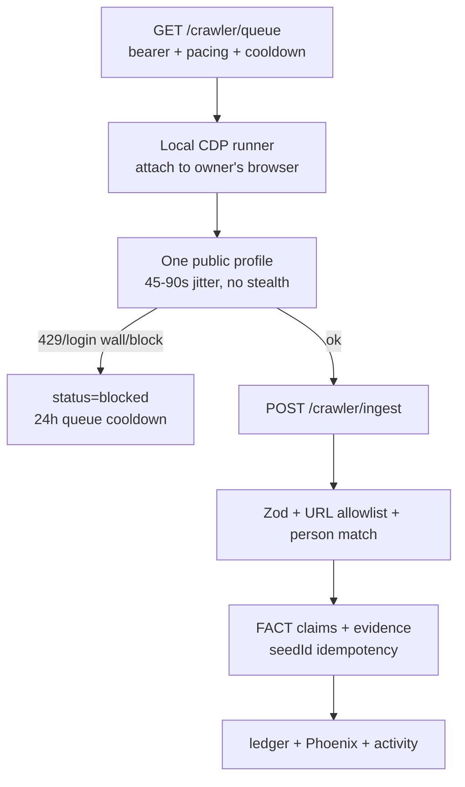

### Summary
The owner's relationship graph has 24 imported people whose only contact signal is a LinkedIn URL, so role, email, and meeting context stay thin. GOVERNANCE.md previously forbade scraping; the owner amended it (#108/#109) to permit a **slow, human-paced crawler, explicitly not consent-gated**. This slice delivers that crawler: a server-side queue/ingest and a local CDP runner that attaches to the owner's own browser, visits public profiles one at a time with a 45–90 second jittered delay, extracts only labelled public fields, and writes them as sourced FACT claims with the profile URL as evidence. A 429, login wall, or block stops the run and cools the queue down for 24 hours — never routed around.

### PDD
The owner starts their own real browser with a debugging port, runs one command, and it walks a bounded queue of stale profiles slowly. Each visit appends a sourced fact to the right person; re-running never duplicates facts, and the graph shows where each fact came from. If LinkedIn challenges the session, the crawl stops and waits a day. No consent prompts and no stealth tooling — the pace and the block-stop are the controls. A quiet profile is fine; invented facts are not.

Job stories:
- As the owner, I want my imported people enriched from their public profiles so the directory shows real roles and locations.
- As the owner, I want the crawl slow and bounded so it cannot turn into bulk harvesting by accident.
- As the owner, I want every crawled fact sourced to the exact profile so I can cite or correct it.

### SDD
1. **Queue (server, `crawler.ts`):** `GET /app-api/crawler/queue` reads people with a sourced `linkedin_url` FACT, excludes retired/duplicate entities, skips profiles visited in the last 30 days, caps at 40 visits/day, and returns pacing bounds (45–90s). A prior `status='blocked'` visit cools the queue for 24h.
2. **Runner (local, `collector/src/crawl.ts`):** attaches over CDP to the owner's own browser (never launches one), opens one tab at a time, dwells 2–5s, extracts labelled public fields (headline, education, location) via anchored regexes on `main`, and posts one visit result. No launch flags, no stealth, no retries, no challenge bypass. `once` visits one profile; `loop` waits a jittered 45–90s between profiles.
3. **URL allowlist:** only `https://(www.)?linkedin.com/in/<slug>`; ingest rejects lookalike hosts, URL mismatches against the person's stored profile, and unknown person ids.
4. **Ingest (server):** `POST /app-api/crawler/ingest` validates with Zod, writes a `crawl_visit` row (ok/blocked/error), and for `ok` writes FACT claims using `/api/epistemic/record` with `seedId = sha256(verb|statement|attribute|normalized URL)[:16]`; existing seedIds are skipped, so replay is idempotent (MR-I1 style). Each claim cites an Evidence row with the profile URL and the verbatim quote. One activity row and one `crawler.ingest` ledger event/Phoenix span per visit.
5. **Failure boundary:** blocked/error visits write no facts and cool the queue; malformed payload or untrusted URL is a 400; Octo failures produce an error result, never a partial silent success. Bearer auth on both routes; unset `CRAWLER_TOKEN` disables them entirely.
6. **Governance:** sensitive-attribute inference, levers, private Slack/Discord, data brokers remain forbidden (GOVERNANCE.md §2/§3 unchanged except the LinkedIn row); only public profile facts are collected.

- Canonical state and ownership: ledger claims are workspace-scoped; one person ↔ one stored profile URL; no entity merging.
- Octo capabilities: `/api/graph/query`, `/api/epistemic/record`, `ri_console.crawl_visit`, ledger, activity.
- Runtime/API contracts: two adapter routes with shared bearer; Zod input schema; deterministic seedId.
- Source/provider data flow: owner's own browser session → public page text → labelled public facts → sourced claims.
- Client surfaces: none (server + local runner only).
- Existing code reused/replaced: collector attach proof (#15), seed/load.py record API and seedId pattern, telemetry.
- Failure boundary: block stops the run; no stealth, no retry, no route-around.
- Current/stale behavior: 30-day freshness; a blocked visit suppresses the queue for 24h.

### Eval / completion oracle
Frozen before implementation.

Public tests (`app/tests/crawler.test.ts`):
- C1 queue excludes retired people and non-LinkedIn URLs; C2 blocked visit sets 24h cooldown; C3 ingest writes one FACT + evidence per new fact with the profile URL; C4 replay writes zero duplicate claims; C5 blocked/error ingest writes no claims; C6 URL allowlist rejects lookalikes and person/URL mismatches; C7 invalid bearer rejected.

Metamorphic relations:
| ID | Transformation | Required relation |
|---|---|---|
| MR-C1 | Ingest same profile twice, permute fact order | Same canonical facts; only visit audit rows may differ |
| MR-C2 | Interleave other workspace | No cross-workspace facts or visits |
| MR-C3 | Replay with modified evidence quote | Existing claim unchanged (append-only) |

Hidden holdout (`app/tests/holdout/crawler.holdout.test.ts`):
- Unseen names and profile slugs; adversarial URLs (evil.com, linkedin.com.evil.com, /company/ pages); oversized/invalid payloads; facts with sensitive-attribute names (must be rejected by attribute allowlist); duplicate facts with different whitespace; blocked visit interleavings.
- Frozen criteria: H1 only allowlisted profile URLs produce writes; H2 no sensitive attribute ever written; H3 replay writes zero new claims; H4 blocked visit writes zero facts and sets cooldown; H5 no cross-workspace writes.
- Production smoke: deploy, confirm `CRAWLER_TOKEN` gates both routes, queue returns 20 stale profiles, one manual `once` run on a test profile writes sourced facts.

Acceptance-to-test traceability: C1→C2, C3→H1/H2, C4→H3/MR-C1, C5→H4, C6→H1, C7→production smoke; MR-C2→H5; MR-C3→H3.

### Identity and Lineage
- Leaf issue: Pukujan/relationship-intelligence#108 (governance decision); this slice follows #109
- Parent: #1 (product program); relates to RI-0008 (#15, local daemon proof) and RI-0022 (#92, agent execution)
- Task/branch: feat/slow-linkedin-crawler; writer agent:dsh/lead
- Defines: `crawl_visit` table and crawler route contract; no new canonical entity type

### Acceptance Criteria
- [ ] Queue returns only stale, allowlisted, non-retired profiles with 45-90s pacing and 40/day cap
- [ ] Blocked visit cools the queue 24h and writes no facts
- [ ] Ingest writes sourced FACT claims with profile URL evidence; replay is idempotent
- [ ] No sensitive attributes, no lookalike URLs, no stealth/stealth flags
- [ ] C1-C7, MR-C1..C3 and frozen holdout pass; CI green; production smoke observed

### Boundaries and Next Action
No bulk crawl, no consent gating, no stealth tooling, no LinkedIn messaging/DMs, no company-page or feed scraping. Next: merge, deploy `CRAWLER_TOKEN`, run the smoke; follow-up slice can add RAG indexing of crawled facts once the source contract holds.

### Issue Type
operational

### Lifecycle Status
open

### Filer Origin (who initiated this filing)
human-via-agent

### Directing Human GitHub Account ID
137629468

### Destination Repository
Pukujan/relationship-intelligence

### Ontology Versions Used
oio=1.1.0; project=1.0.0

### Project Priority Path
2

### Project Priority Concept ID
pukujan-relationship-intelligence:priority-2

### Affected App, Adopter, Users, or Systems
Relationship Intelligence adapter crawler routes, Octo ledger, local collector runner on the owner's Mac.

### Observed Consequence and Workaround
Imported people carry LinkedIn URLs but no derived role/location/education; workaround is manual entry.

### Evidence Confidence
confirmed

### Impact if Unresolved
moderate

### Likelihood
observed

### Exposure
not-currently-exposed

### Exposure Duration
Present since the owner's relationship import (#71/#72); observed 2026-11-21.

### Recoverability
documented-recovery

### Recovery Evidence
Additive server module + local runner; no canonical schema change; revert commit redeploys by Komodo; no sends or external writes.

### Risk if the Observation Remains Unresolved
The people directory stays thin and warm-intro preparation lacks basic role/location context.

### Risk Introduced by a Proposed Change
A slow crawler still automates LinkedIn access, which its User Agreement forbids; the owner explicitly accepted this contractual risk in #108 and chose a slow pace over consent gating. Pacing, daily cap, and block-stop bound the operational risk; the allowlist and attribute enum bound the data risk.

### Product or Release Relevance
supports

### Named Product Outcome and Cost of Delay
People profiles show sourced public role/location/education within 30 days of a profile visit; delay keeps manual enrichment as the only path.

### Cost of Delay
Every new importedperson starts with a LinkedIn URL and empty context.

### Smallest Useful Product Slice
Server queue + ingest + local CDP runner for public profile facts, paced 45-90s, capped 40/day, with block cooldown and idempotent sourced writes.

### Provenance and Context
- Repository: Pukujan/relationship-intelligence
- Source direction: owner conversation 2026-11-20/21 ('slow crawler not consent gated'; 'go')
- Code evidence: collector/src/attach.ts (#15 proof), GOVERNANCE.md amended #109

### Session, Authorization Evidence, and Instruction Reference
- Session reference: DSH root agent lead, 2026-11-20/21
- Claimed instruction/source: owner said 'no remove that bulk linkedin harvesting rule all i said was a slow crawler not consent gated' then 'go'
- Authorization evidence: claimed pending separate GitHub account attestation

### Content Author Account or Runtime Identity
agent:dsh/lead

### Reproducibility Steps and Evidence
1. Read GOVERNANCE.md §2/§3 after #109: slow crawl OK, no consent gate.
2. Run `tsx src/crawl.ts once` with a CDP browser and token; one visit writes sourced facts.
3. Re-run: seedId dedupe writes zero new claims.

### Hypotheses (unverified)
- H1: The #15 attach proof is sufficient transport. Status: confirmed. Experiment: attach.ts connects over CDP and reads own profile.
- H2: Page text regex extraction is reliable. Status: uncertain — holdout covers thin profiles; weak extracted facts are still sourced and reviewable.

### Counter-signal
The original governance forbade scraping for privacy/ToS reasons; the owner knowingly overrode that for a slow paced crawl, so this packet states the residual contractual risk openly.

### Honest Caveat
LinkedUI selectors change; extraction may yield thin facts. Every fact stays sourced to the exact URL and enters the ledger as FACT, so corrections are append-only.
